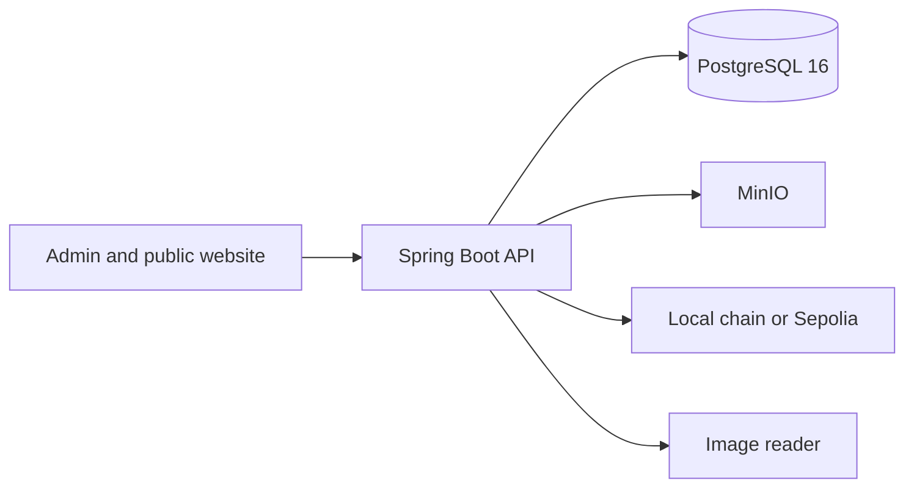

# CertiChain

CertiChain issues a digital certificate and anyone can check it from a public link. The certificate file stays off-chain. An SHA-256 fingerprint is what later gets anchored. Records in this project are synthetic. They are not real academic credentials.

## Architecture



The admin console and the public verification page use the API. Issuing a certificate writes an SHA-256 fingerprint, stores a PDF in MinIO, and registers that fingerprint in the `CertificateRegistry` contract. By default the contract runs on a local Anvil chain whose state is stored in a Docker volume, so a restart keeps the same contract and transactions. Set `CHAIN_RPC_URL`, `CHAIN_PRIVATE_KEY`, and `CHAIN_ID=11155111` to anchor on Sepolia instead. Do not commit a funded key. The public Anvil development key in the dev profile must never be funded on a public network.

## Run the API

Java 21, Maven, and Docker are required.

```bash
docker compose up -d
cd backend
mvn spring-boot:run
```

- Health: http://localhost:8080/actuator/health
- API docs: http://localhost:8080/swagger-ui.html

The dev profile connects to `localhost:5433` with the database, user, and password `certichain`. Port 5433 is used so this does not collide with a PostgreSQL service already installed on Windows. Override those values with the variables in `.env.example`. Do not commit a `.env` file.

## Run the website

```bash
cd frontend
npm install
npm run dev
```

Open http://localhost:5173 and sign in with `admin@certichain.local` / `certichain`. A public check such as http://localhost:5173/verify/CERT-2026-001245 can download the issued PDF, confirm that file, or scan a PDF, text record, or image.

Student wallet: `student@certichain.local` / `certichain`. That account sees credentials issued to the student record with the same email. Uploaded files stay "User uploaded — not verified".

Verifier desk: `recruiter@certichain.local` / `certichain`. It can check a credential ID and open a share link. It cannot list another person's wallet.

Flyway applies wallet and signing migrations on API startup. Wallet files go in the existing private MinIO bucket under random `wallet/` keys. Share links store a SHA-256 of the token. The OCR service at `OCR_URL` is optional; if it is down, uploads still save and no text suggestion is shown. OCR never marks a document genuine.

A QR code is the public URL `/verify/{credentialId}`. On a laptop that URL is local. Production needs HTTPS.

The public verification page also lists each check separately: issuer record, detached signature, file fingerprint, revocation, expiry, and chain anchor. A missing signature is not treated as a pass. If `CERTICHAIN_SIGNING_PRIVATE_KEY` and `CERTICHAIN_SIGNING_PUBLIC_KEY` are both set, those keys are used and are not written into source control. If they are blank, an institution admin supplies the key in Settings. The private key stays on the server so new credentials can be signed, and it is not returned again. Each credential stores only the public key from issuance. A key created automatically by an older demo is not used for new signatures. Existing issued credentials with a blank signature are signed on startup when a key is configured. The signature is not part of the chain hash, so this does not re-anchor them. Rotating the key does not rewrite old signatures; each credential keeps the public key stored at issuance. Stop using a compromised key and revoke credentials that were signed with it.

PDF text is read in the API. When a PDF has no embedded text, the API asks the Python service to render pages and OCR them. Image OCR stays in that service at `OCR_URL` (`/extract` and `/analyze`). Rebuild the `ocr` container after changing that service. Neither path marks a document genuine.

Share links that expire within 24 hours create an in-app notice for the owner. The notice does not include the secret token or the document. Email is sent only when `SPRING_MAIL_HOST` is set and the recipient looks like an email address. With that unset, nothing is emailed and the app does not claim that mail was sent.

`CLAMAV_HOST` is optional. When it is empty, uploads are stored as `UNSCANNED` and are not described as clean. When it is set, the API uses ClamAV INSTREAM. An unreachable scanner stores the file as `SCAN_UNAVAILABLE`. A file the scanner rejects is not stored.

Sepolia still needs your own RPC URL and a funded key in Settings or the environment. The local Anvil key is rejected for chain id 11155111. Anchoring on Sepolia is not simulated.

## Tests

```bash
cd backend
mvn test
```
